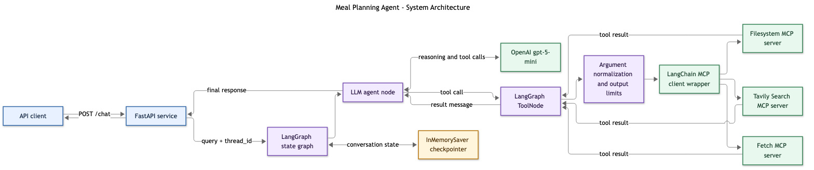
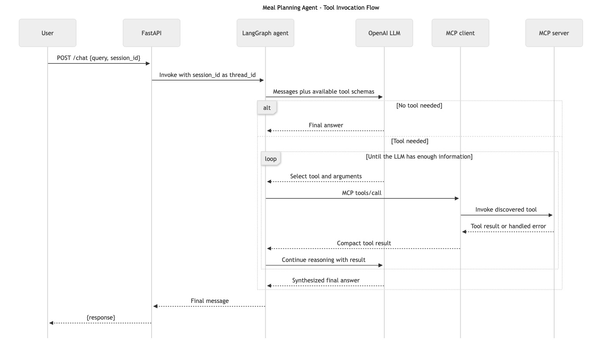
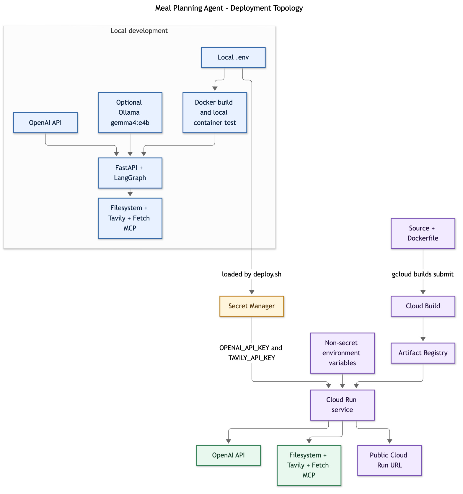

# Meal Planning Agent

A LangGraph meal-planning agent that researches recipes, inspects source pages,
saves meal plans and preferences, and remembers conversations by `session_id`.
It exposes a FastAPI service and integrates three real MCP servers.

## Features

- Semantic tool selection: the model can answer directly, call one tool, or
  chain several tools.
- Three MCP integrations with real tool discovery and invocation:
  Filesystem, Tavily Search, and Fetch.
- LangGraph conversational memory scoped by `session_id`.
- Graceful handling of unavailable MCP servers, tool errors, and malformed
  tool content.
- Local Ollama development and OpenAI-backed Cloud Run deployment.
- `POST /chat` API matching the assignment contract.

## Architecture

### 1. System architecture



### 2. Tool invocation flow



### 3. Deployment topology



Editable Mermaid sources for all three diagrams are stored beside the JPGs in
the `docs/` directory.

## MCP servers

The application discovers every server independently through
`MultiServerMCPClient.get_tools()`, which performs MCP tool discovery. Tool
calls are executed through the returned MCP tools rather than simulated in the
application.

- [Filesystem MCP](https://github.com/modelcontextprotocol/servers/tree/main/src/filesystem)
  reads and writes preferences and meal plans inside one configured directory.
- [Tavily MCP](https://docs.tavily.com/documentation/mcp) finds current recipe
  pages and sources.
- [Fetch MCP](https://github.com/modelcontextprotocol/servers/tree/main/src/fetch)
  retrieves the selected recipe page so the agent can inspect it before saving.
  Fetch is the additional third MCP server because search snippets alone are
  insufficient for validating ingredients and instructions.

The small active tool set keeps prompts focused while all server tools are
still discovered for verification. `/health` reports both discovered and bound
tools, plus any degraded server state.

## API

### Health

```http
GET /health
```

### Chat

```http
POST /chat
Content-Type: application/json

{
  "query": "Find a vegetarian pad thai recipe and save it.",
  "session_id": "demo-session"
}
```

Response:

```json
{
  "response": "..."
}
```

Reuse the same `session_id` for follow-up turns. Memory lasts for the lifetime
of the running instance. It is intentionally not durable across Cloud Run
instance replacement or scale-to-zero.

## Local setup

Requirements:

- Python 3.13
- Node.js and npm for Filesystem MCP
- An OpenAI API key
- A Tavily API key
- Optional: Ollama with `gemma4:e4b`

Create the environment:

```bash
python3.13 -m venv .venv
source .venv/bin/activate
pip install -r requirements.txt
cp .env.example .env
```

Edit `.env` and replace the placeholder API keys. `.env` is ignored by Git.
The default configuration uses OpenAI `gpt-5-mini`. To use Ollama locally,
set `LLM_PROVIDER=ollama`.

Run the service:

```bash
source .venv/bin/activate
python main.py
```

It listens on `http://localhost:8080` by default.

```bash
curl -sS http://localhost:8080/health
```

## Testing

The live suite starts an isolated FastAPI process and makes real OpenAI,
Tavily, Fetch, and Filesystem MCP calls:

```bash
source .venv/bin/activate
python live_test.py
```

To test the deployed service and verify selected tools through Cloud Logging:

```bash
python live_test.py \
  --base-url https://meal-planning-agent-245569006163.us-west1.run.app
```

It covers discovery, request validation, no-tool reasoning, multi-tool
reasoning, filesystem operations, tool errors, conversation memory, session
isolation, malformed content, and connection failure degradation. The local
suite has 12 cases, including transport-failure injection. The remote-safe
suite omits that destructive fault injection; its latest run passed all 11
cases against Cloud Run.

## Docker

Build locally:

```bash
docker build -t meal-planning-agent .
```

Run with local environment variables:

```bash
docker run --rm -p 8080:8080 --env-file .env meal-planning-agent
```

The image runs as a non-root user, includes Node.js/npm for the Filesystem MCP
server, and preinstalls Fetch MCP's Readability dependencies at build time.
Never copy `.env` into an image.

## Google Cloud Run deployment

Current deployment:

- Project: `meal-planner-agent-511321`
- Region: `us-west1`
- Service: [`meal-planning-agent`](https://meal-planning-agent-245569006163.us-west1.run.app)
- Health: [`/health`](https://meal-planning-agent-245569006163.us-west1.run.app/health)

Revision `meal-planning-agent-00004-9tx` passed all 11 deployment-safe tests,
including OpenAI responses, three-server MCP discovery, Search/Fetch/Filesystem
chaining, error recovery, conversation memory, and session isolation.

Prerequisites:

- Google Cloud CLI installed
- A Google Cloud project with billing enabled
- Permission to enable APIs, run Cloud Build, create Artifact Registry
  repositories and secrets, and deploy Cloud Run services

Initialize the CLI and choose the correct USC Google account and project:

```bash
gcloud init
```

Set `GCP_PROJECT_ID` in `.env`, then deploy:

```bash
chmod +x deploy.sh
./deploy.sh
```

The script:

1. Enables Cloud Run, Cloud Build, Artifact Registry, and Secret Manager.
2. Creates a regional Artifact Registry repository if needed.
3. Creates a dedicated Cloud Run runtime service account.
4. Stores the OpenAI and Tavily keys in Secret Manager.
5. Builds the Docker image with Cloud Build.
6. Deploys the service publicly in `us-west1` with zero minimum and one maximum
   instance.
7. Prints the stable service URL and health-check command.

After deployment, test the live endpoint:

```bash
SERVICE_URL="$(gcloud run services describe meal-planning-agent \
  --region us-west1 --format='value(status.url)')"

curl -sS "$SERVICE_URL/health"

curl -sS -X POST "$SERVICE_URL/chat" \
  -H 'Content-Type: application/json' \
  -d '{"query":"How do I cook white rice?","session_id":"cloud-smoke-test"}'
```

Keep `--max-instances 1` for this assignment because conversational memory is
stored in-process. Files saved by Filesystem MCP are also ephemeral and may be
lost when Cloud Run replaces the instance.

## Cost disclosure

This project can incur usage-based charges from OpenAI, Tavily, Cloud Build,
Artifact Registry, Secret Manager, and Cloud Run. Cloud Run uses
`--min-instances 0`, so it can scale to zero while idle. The deployment caps the
service at one instance, and `gpt-5-mini` is selected to limit model cost. Check
the relevant provider dashboards during testing and leave the service running
through grading as required by the assignment.

## Project structure

- `agent.py` - model configuration, MCP discovery, tool limits, and LangGraph
- `main.py` - FastAPI endpoints and Cloud Run-compatible server entrypoint
- `live_test.py` - real end-to-end functionality suite
- `Dockerfile` - non-root Cloud Run container
- `deploy.sh` - build, secret setup, and deployment automation
- `docs/` - required architecture diagrams as JPGs plus editable Mermaid sources
- `PROCESS_LOG.md` - development and verification narrative
